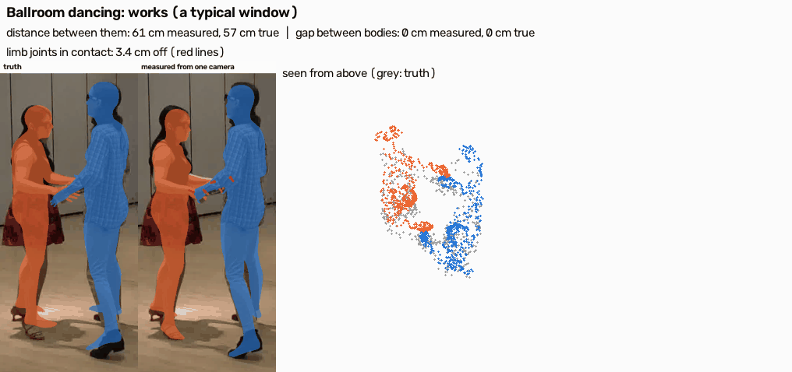
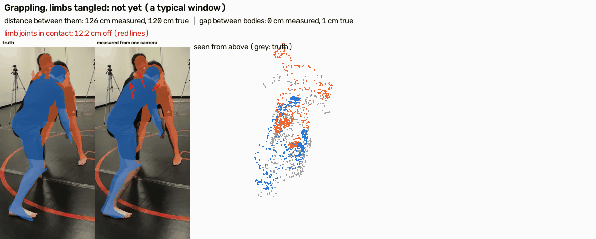
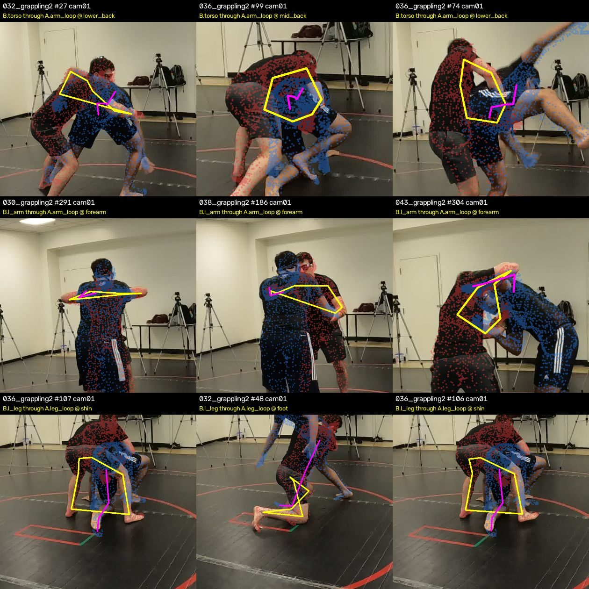
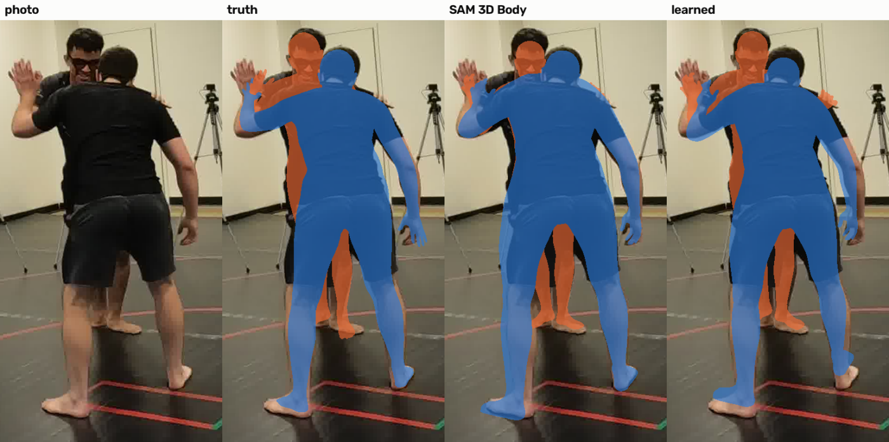
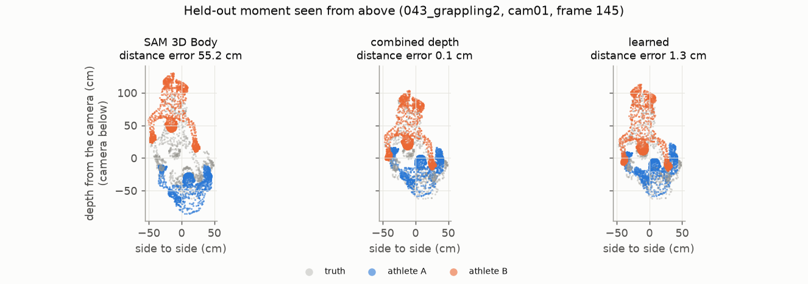

# engage3D — measuring how two people engage, in 3D, from one camera

Research code and pre-registered experiments on measuring **two-person engagement** (where two people touch, which
body surfaces meet, whose limbs wrap whom) as 3D quantities, from ordinary single-camera video. Test domains:
standing grappling and MMA (Harmony4D, multi-view 3D ground truth) and Brazilian jiu-jitsu ground work (ViCoS, expert
position labels). The relations generalise to any close human interaction.

Every experiment except the E22 demo is **pre-registered**: its pass criteria are committed before it runs (see the
commit history), and its results are reported against them, failures included. One folder per experiment: [`experiments/`](experiments/).
Findings log: [`FINDINGS.md`](FINDINGS.md). Plan: [`docs/RESEARCH_QUEUE.md`](docs/RESEARCH_QUEUE.md).

## Where it works, and where it doesn't yet
One camera against the 3D truth, on Harmony4D sequences never used for training. Each clip is a typical stretch,
chosen by rule (the window whose median error matches the activity's overall result), not the best-looking one.

**Ballroom dancing: works.** The two dancers' distance is right to 2.7 cm (median), whether they touch to F1 0.96, and
limbs in contact to 3.8 cm ([E20](experiments/E20-calmer-contact/)).

**Grappling with limbs tangled: not yet.** Where the two bodies are is right (distance 3.2 cm), but limbs hidden at the
contact are 4-6 cm off (red lines: measured joint -> true joint). Hugging fails the same way: the arms hide behind the
partner. **What has been tried for this:** the body model's own pose token ([E10](experiments/E10-limb-head/), fail),
fine-tuning its decoder ([E11](experiments/E11-decoder-finetune/), fail), information over time
([E14](experiments/E14-temporal-limbs/), fail: the errors persist across frames), and better 2D as clicks (true 2D
helps -15% / -25%, [E18](experiments/E18-oracle-clicks/); a contact-trained keypoint model does not yet,
[E19](experiments/E19-contact-2d-keypoints/)). **Now:** RF-DETR keypoints and person masks trained on contact, end to
end with no ground-truth boxes ([E16](experiments/E16-end-to-end-rfdetr/), running), and a per-frame trust flag that
says when a measurement can be used ([E17](experiments/E17-confidence/); [E17b](experiments/E17b-trust-flag-deeper/):
with three phones, taking each moment from the camera the flag trusts most halves the distance error).

From the camera, a single-camera 3D body model looks right. From above, it puts one athlete 55 cm too far back; the
combined depth fixes it:

## Where it stands (October 2026)
Single-camera pipeline: **SAM 3D Body** (one body per person) -> **combined depth** (a monocular depth map from MoGe-2
blended with SAM 3D Body's own estimate of the depth gap between the two people) -> **learned placement correction**
(a small network that moves and turns each body).

| Harmony4D, held-out sequences (1,068 views) | SAM 3D Body | + combined depth | + learned correction |
|---|---|---|---|
| distance between the two athletes, median error | 11.2 cm | 3.95 cm | **3.17 cm** |
| relative depth between them, median error | 16.0 cm | 5.8 cm | **4.3 cm** |
| which body surfaces touch (region-pair F1) | 0.46 | 0.55 | **0.60** |
| hand fighting (arm through arm loop, F1) | 0.41 | 0.42 | **0.55** |
| loop balance (sign agreement) | 41% | 49% | **56%** |

- **New people:** trained on one pair of athletes, the correction keeps about two-thirds of its gain on a different
  pair doing MMA (distance 5.07 -> 4.30 cm) ([E08](experiments/E08-new-people/)).
- **Ground work** (no 3D truth): the combined depth raises the defining relations of mount (0.14 -> 0.29), closed
  guard (0.20 -> 0.33) and back control (0.39 -> 0.64) without false positives in control positions
  ([E05](experiments/E05-vicos-combined-depth/)).
- **Beyond grappling:** ballroom dancing is measured well (the two dancers' distance within 2.7 cm, touching F1
  0.96, limbs in contact 3.8 cm), hugging less so (arms hidden behind the partner), and at range (sword fighting,
  2.4 m apart) the distance is right to about 4% ([E20](experiments/E20-calmer-contact/),
  [E21](experiments/E21-engagement-at-range/)).
- **Six layers on whole clips, without ground-truth boxes** (E22, a demo, not pre-registered): people, masks,
  skeletons, 3D bodies in one space, contact events and a narration, on 12 clips with truth from sword sparring to
  grappling and 17 ordinary videos. 0 identity switches; distance between the two 1.5-5.1 cm off on Harmony4D;
  touching F1 0.96-1.00 on hugging, ballroom and grappling, 0.59-0.75 on strikes
  ([E22](experiments/E22-layered-engagement/)).
- **Limits:**
  - the tables above used ground-truth person boxes; E22 (no ground-truth boxes, whole clips) and E16 (running)
    measure what real detection costs;
  - SAM 3D Body was trained on Harmony4D (all 24 subjects; [arXiv 2602.15989](https://arxiv.org/abs/2602.15989), Table 1),
    so its absolute errors on Harmony4D, including the MMA "new people", are likely optimistic; comparisons within an
    experiment are unaffected, and unseen data (MAMMA's motion-capture evaluation, real footage) is the honest test;
  - all Harmony4D grappling is two pairs of athletes, too few to measure how athlete variety helps
    ([E09](experiments/E09-athlete-variety/));
  - leg entanglements and loop balance are not yet reliable, and what remains is limb error inside tangles.

## Layout
- `src/`: the code (flat modules; each script states its environment and usage in its docstring). Paths to data and
  models: `src/engage_paths.py` (environment variables `ENGAGE3D_*`).
- `experiments/E<nn>-<name>/`: `README.md` (summary), `PREREG.md` (committed before the run), `RESULTS.md`, and
  `data/` (the aggregate outputs the results quote). E04's results are in E03; E22, a demo, has no pre-registration.
- `docs/`: measurement spec, capture design, research queue.
- `env/`: pinned package lists of the nine environments (`venv-<name>.txt`; `venv-base` is the CPU environment; Python
  3.11-3.14, CUDA 12/13). Each script names its environment in its docstring.
- `tools/sync_from_workspace.py`: how this repo is exported from the private research workspace, with a privacy check.

## Data and models (not redistributed here)
- **Harmony4D** (Khirodkar et al., NeurIPS 2024; dataset card: MIT): `Jyun-Ting/Harmony4D` on Hugging Face.
  `src/engage_h4d_fetch.py` pulls selected cameras and frames straight out of the online zips.
- **ViCoS BJJ positions** (Hudovernik & Skocaj, MMSports'22; CC BY-NC-SA 4.0).
- **Models:**
  - SAM 3D Body and SAM 3 / 3.1 (Meta, SAM License);
  - MoGe-2 (`Ruicheng/moge-2-vitl-normal`) and Depth Pro (`apple/DepthPro`);
  - ViTPose+ (`usyd-community/vitpose-plus-base`);
  - PromptHMR (non-commercial research); SMPL / SMPL-X (their own licences).
- **MAMMA** (two-person motion capture, Max Planck Institute for Intelligent Systems, mamma.is.tue.mpg.de): used in E22
  to score clips only. Its media and derived data are not redistributed.
- **Published model:** the learned placement correction v1 (E06),
  [`0xdhruva/engage3d-placement-v1`](https://huggingface.co/0xdhruva/engage3d-placement-v1), trained on Harmony4D
  only. No model trained on MAMMA data or on private footage is released.

## Related research
Earlier threads that led here, each with its own experiments and negative results: [movement-research](https://github.com/dhruvinci/movement-research) (camera and measurement under contact), [limb-entanglement](https://github.com/dhruvinci/limb-entanglement) (whose limb is whose), [fast-slow-vision](https://github.com/dhruvinci/fast-slow-vision), [kakashi-autolabel](https://github.com/dhruvinci/kakashi-autolabel). Index: [dhruvinci/research](https://github.com/dhruvinci/research).

## Licence
Code: MIT ([`LICENSE`](LICENSE)). Documents and results: CC BY 4.0. Third-party data and models keep their own
licences.

## Citation
See [`CITATION.cff`](CITATION.cff).
