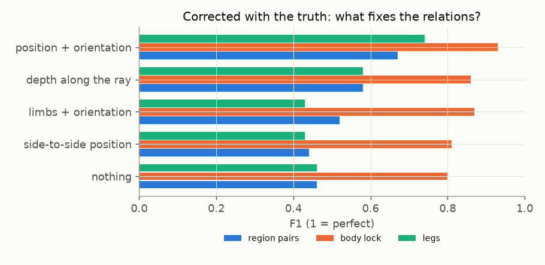

# E01 — Joint rigid fit, and what actually breaks the relations

**Objective.** Can a cheap fix (both bodies fitted jointly to 2D keypoints, with no overlap allowed) make single-camera
measurement work?

**Setup.** A pre-registered fit (criteria P1-P5). After it failed: an oracle that corrects one kind of error at a time
with the truth, plus a camera-count test.

**Results**
| | baseline | joint fit | target |
|---|---|---|---|
| distance error | 10.2 cm | 10.1 | <= 6 |
| region pairs | 0.47 | 0.43 | >= 0.57 |
| legs | 0.46 | 0.36 | >= 0.56 |
- Relative depth between the athletes is 14.5 cm off, against 5.0 cm side to side.
- Correcting depth alone passes the distance, surface and leg targets.
- A second camera at about 90 degrees: distance 10.2 -> 3.3 cm.

**Verdict.** **Fail.**
**Learned.** The missing quantity is **depth along the camera's line of sight**, not limbs. 2D keypoints cannot
recover it.
**Next.** A whole-image model ([E02](../E02-prompthmr/)) and a depth-map cue ([E03](../E03-depth-map/)).

Files: `PREREG.md`, `RESULTS.md`.
