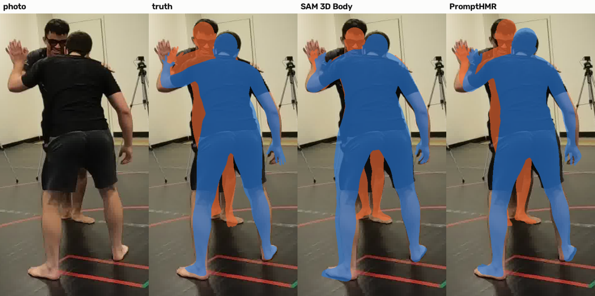

# E02 — A whole-image multi-person model (PromptHMR)

**Objective.** Does a model that sees both people in one pass place them better than a per-person crop model?

**Setup.** PromptHMR on the same views and boxes, against E01's pre-registered criteria.

**Results** (Harmony4D grappling)
| | SAM 3D Body | PromptHMR |
|---|---|---|
| distance error | 10.2 cm | **6.1** |
| body lock | **0.80** | 0.50 |
| legs | **0.46** | 0.30 |
- On ground work it rebuilt the same athlete twice in 40-44% of mount and guard frames.

**Verdict.** **Fail.** Placement is better; limbs in tangles are much worse.
**Learned.** Each athlete is about 200 px in its whole-image encoding: a resolution limit, which fine-tuning won't fix.
**Next.** Keep per-person crops; fix depth with a depth map ([E03](../E03-depth-map/)).

Files: `PREREG.md`, `RESULTS.md`.
