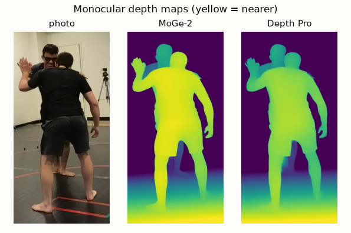
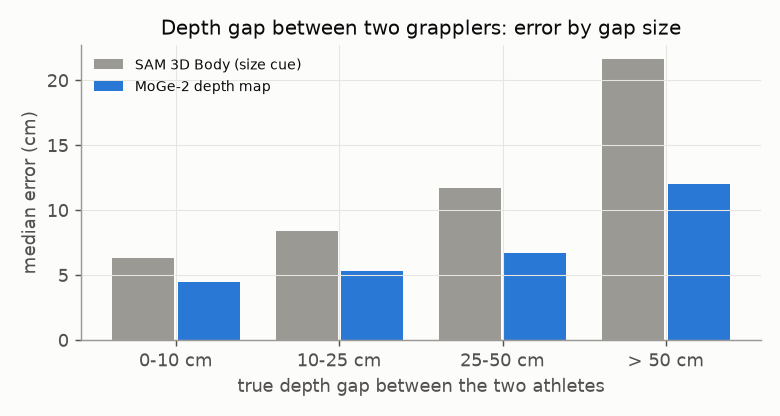

# E03 — Relative depth from a monocular depth map

**Objective.** Body models judge distance from apparent size: an error that grows with the distance to the camera. Do
depth-map models (MoGe-2, Depth Pro) get the depth gap between two people better?

**Setup.** 912 Harmony4D views. The depth model runs on an undistorted crop with the true focal length. Each body is
moved along its camera ray to agree with the map.

**Results**
| depth gap between the athletes | median error |
|---|---|
| SAM 3D Body | 14.0 cm |
| MoGe-2 depth map | 8.4 cm |
| **combined** (0.7 map + 0.3 SAM 3D Body; weight held out by sequence) | **6.0 cm** |
- The map alone, pre-registered: distance 10.3 -> 5.2 cm, but body lock drops (0.76 -> 0.68). **Fail.**
- The map shrinks gaps (0.84x) and the body model stretches them (1.20x), so combining them cancels the biases.
- Failed follow-ups: orientation from the map, edge-only or interior-only pixels, temporal averaging, and re-fitting
  to 2D keypoints.

**Verdict.** The map alone **fails**. The combination is the best single-camera placement so far (tested in
[E04](../E04-combined-depth-fresh-test/)).
**Learned.** Two cues with opposite biases beat either one. The map places the two people; it doesn't orient them.

Files: `PREREG.md`, `RESULTS.md`.
