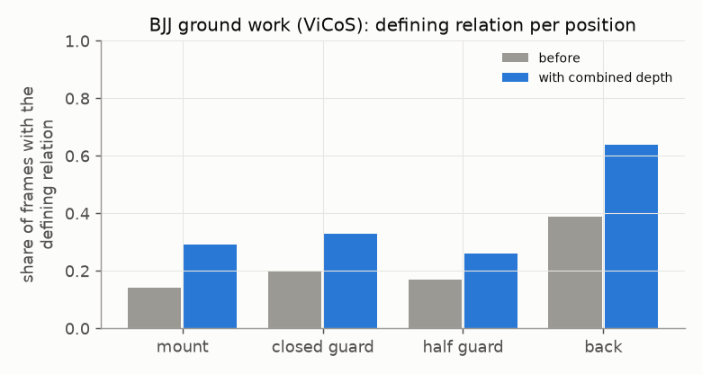

# E05 — The combined depth on BJJ ground work (ViCoS)

**Objective.** Does the combined depth carry over to real ground positions, filmed on phones, with no 3D truth
available?

**Setup.** 1,426 ViCoS frames, settings fixed in advance. The test: does each expert-labelled position show the
relation that defines it, while control positions stay low?

**Results**
- Mount 0.14 -> **0.29**, closed guard 0.20 -> **0.33**, half guard 0.17 -> **0.26**, back 0.39 -> **0.64**.
- Controls (standing, takedown, turtle, side control) stay <= 0.20; duplicated athletes <= 10%.

**Verdict.** **Pass.** It carries over in direction, the strongest claim possible without 3D truth.
**Learned.** The rates are still about half what the definitions imply (about 0.60).
**Next.** A reliability score from ViCoS's synchronised phones (queued E12). Real 3D truth for ground work needs
capture.

Files: `PREREG.md`, `RESULTS.md`.
