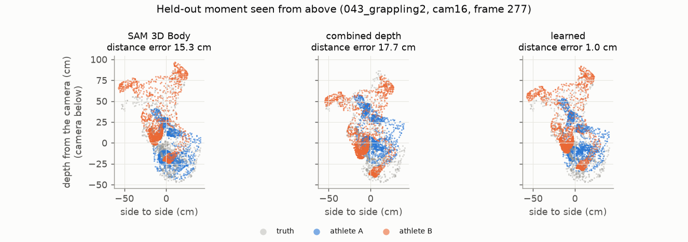

# E06 — A learned two-person placement correction (v1)

**Objective.** Learn the correction no hand-built rule found: move and turn each body so the pair matches the truth.

**Setup.**
- A small MLP (an ensemble of 3), trained on the CPU in minutes.
- Inputs: both bodies' key points after the combined depth, where the depth map disagrees with each body part, and
  2D keypoint residuals.
- Held-out test: 4 sequences, 1,068 views, criteria fixed in advance.

**Results** (held-out sequences)
| | SAM 3D Body | combined depth | **learned** |
|---|---|---|---|
| distance error | 11.2 cm | 3.95 | **3.17** |
| relative depth | 16.0 cm | 5.8 | **4.3** |
| region pairs | 0.46 | 0.55 | **0.60** |
| hand fighting | 0.41 | 0.42 | **0.55** |
| loop balance | 41% | 49% | **56%** |

**Verdict.** **Pass (5/5).** One camera now places two grapplers about as well as two cameras with naive fusion.
**Caveat.** The test has few true leg and body-lock cases (8 / 68 views).
**Next.** More training views ([E07](../E07-placement-model-v2-cameras/)); new people ([E08](../E08-new-people/)).

Files: `PREREG.md`, `RESULTS.md`. Weights: [`0xdhruva/engage3d-placement-v1`](https://huggingface.co/0xdhruva/engage3d-placement-v1)
