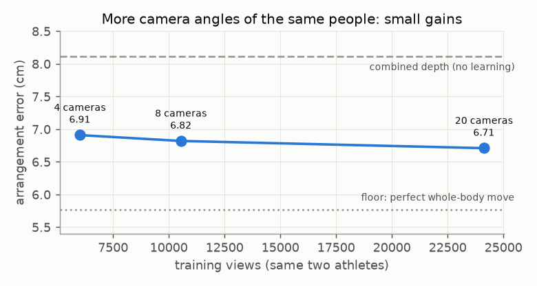

# E07 — More camera angles of the same athletes (v2)

**Objective.** Does training on all 20 Harmony4D cameras, rather than 4, make a better model?

**Setup.** Overnight processing of 21,000 extra views (6,012 -> 27,100). A learning curve, plus variants: wider network,
SAM 3D Body's internal tokens, overlap features. Then a pre-registered test against v1.

**Results**
| test | v1 | v2 |
|---|---|---|
| distance error | 3.18 cm | **3.12** |
| relative depth | **4.30** cm | 4.35 |
| extended test (2,136 views): distance / depth | 3.13 / 4.30 | **2.94 / 4.08** |
- Tokens and overlap features: no robust gain.

**Verdict.** **Fails by 0.04 cm** on relative depth; v1 stays.
**Learned.** More angles of the same two people: small, consistent, flattening gains.
**Next.** Variety of athletes ([E08](../E08-new-people/), [E09](../E09-athlete-variety/)).

Files: `PREREG.md`, `RESULTS.md`.
