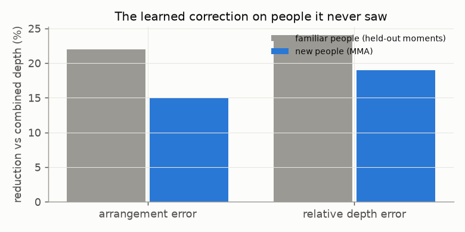

# E08 — Does the correction work on new people?

**Objective.** All local Harmony4D grappling is one pair of athletes. Does the correction transfer to people it never
saw?

**Setup.** Trained on that pair only; tested on every view of a different pair doing MMA (4,460 views). Criteria
fixed in advance.

**Results** (MMA)
| | combined depth | + correction |
|---|---|---|
| arrangement error | 9.10 cm | **7.73** (-15%) |
| relative depth | 7.54 cm | **6.08** (-19%) |
| distance error | 5.07 cm | **4.30** |
| region pairs | 0.41 | **0.46** |

**Verdict.** **Pass (3/3).** About two-thirds of the gain transfers to new people (and a new activity).
**Next.** Test whether athlete variety closes the rest ([E09](../E09-athlete-variety/)).

Files: `PREREG.md`, `RESULTS.md`.
