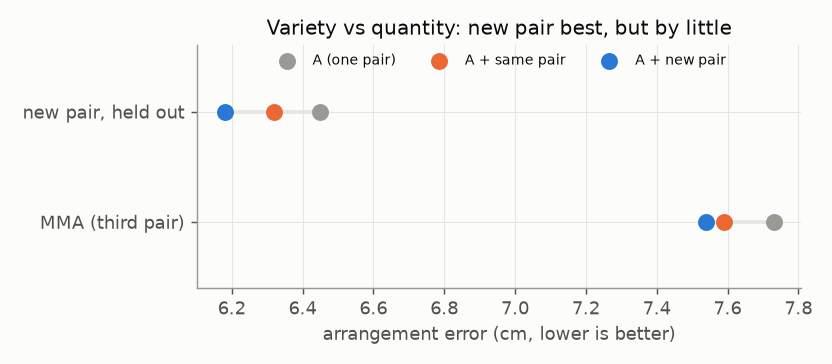

# E09 — Athlete variety vs data quantity

**Objective.** Is the lever more data, or more different people?

**Setup.**
- Pulled from Harmony4D's training split straight out of the online zips (no full download).
- Three models: one pair (A); A + 3,464 views of **the same pair**; A + 3,120 views of **a new pair**.
- Tested on a third pair (MMA) and on the new pair's held-out sequences.

**Results**
- A + new pair is best everywhere, by small margins: MMA 7.54 vs 7.59 cm; new-pair test 6.18 vs 6.32 cm.
- Relative depth on the new pair: 3.97 -> 3.41 cm.

**Verdict.** **Fail.** Both margins are below the pre-registered thresholds (0.10 / 0.20 cm).
**Learned.** Harmony4D has only two grappling pairs: too few to measure how variety pays off. The correction is also
near its own limit: what remains is limb error inside tangles.
**Next.** Fine-tune the body model's limbs (queued E10 / E11). Capture with >= 5 pairs
([capture design](../../docs/CAPTURE_DESIGN.v0.md)).

Files: `PREREG.md`, `RESULTS.md`.
