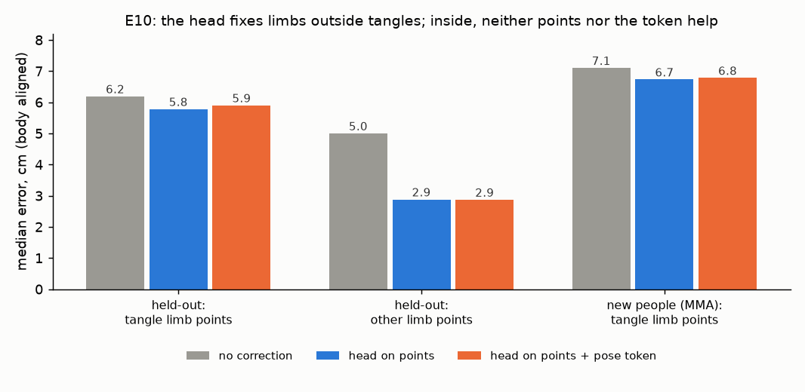

# E10 — Can SAM 3D Body's own pose token fix limbs inside tangles?

**Objective.** Before fine-tuning the body model (E11), test the cheap route: a small head that reads SAM 3D Body's
final pose token and corrects each athlete's limbs.

**Setup.**
- Per athlete: its own 19 points, the other athlete's points, and (variant) the pose token (64 principal components).
  Target: the truth aligned rigidly onto the prediction, so the head learns pose, not placement.
- Compared with the same head without the token, a shuffled token, and no correction. Trained on 22,640 development
  views; tested on the E06 views (1,068) and on new people (MMA, 1,484). Criteria fixed in advance.

**Results** (median error after aligning each body, cm)
| | no correction | head on points | + pose token |
|---|---|---|---|
| held-out, limb points inside a tangle | 6.19 | **5.78** | 5.90 |
| held-out, other limb points | 5.00 | 2.88 | **2.87** |
| new people, limb points inside a tangle | 7.10 | **6.73** | 6.78 |

**Verdict.** **Fail** (L1, L2, N1 fail; L3, L4 pass). The token adds nothing inside tangles (+2.1%, interval
+0.4% to +3.8%).
**Learned.** Outside tangles the limb error is mostly fixed and learnable from the points alone (5.0 -> 2.9 cm).
Inside tangles, and in the arms above all, the information is not in the decoder's final token.
**Next.** E11: fine-tune SAM 3D Body's decoder on two-person contact, targeting how it reads the contested pixels.

Files: `PREREG.md` (committed before the run), `RESULTS.md`. Code: `src/engage_limb_head.py`.
