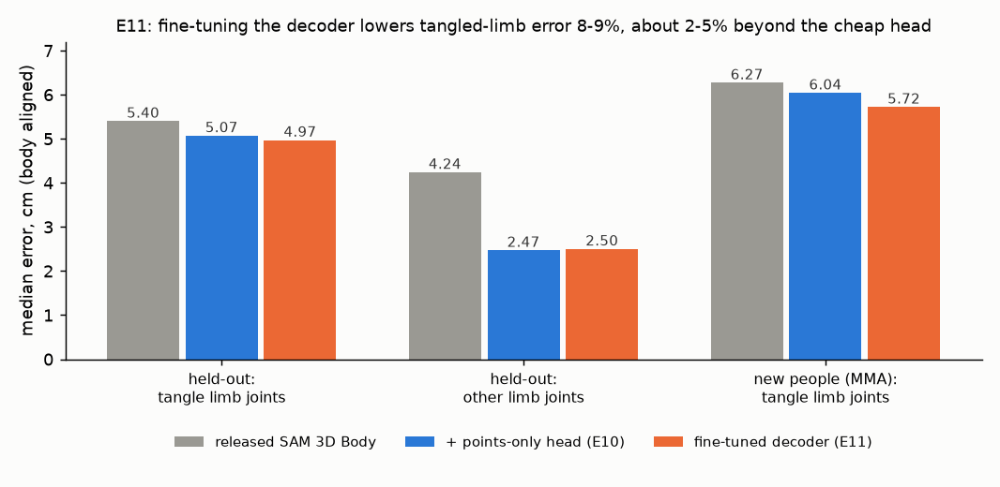

# E11 — Fine-tune SAM 3D Body's decoder on two-person contact (local pilot)

**Objective.** E10 showed the decoder's final token holds no extra limb information inside tangles. Can training the
decoder itself on Harmony4D contact fix limbs inside tangles, for new people too?

**Setup.**
- Backbone and body-model head frozen; only the body decoder (39.4M parameters) trains, on 10,000 athlete crops from
  10 development sequences (contact-weighted), 3 epochs, on the laptop GPU (under 5 GB).
- Loss: rigid-aligned error over the 14 points both body models define alike, tangled limbs weighted 3x, with a
  learned fixed offset per point. Measured on the E06 held-out views and on new people (MMA). Criteria fixed in advance.

**Results** (median error of the 8 limb joints, cm)
| | released | + points-only head (E10) | **fine-tuned decoder** |
|---|---|---|---|
| held-out, inside tangles | 5.40 | 5.07 | **4.97** |
| held-out, other limb joints | 4.24 | **2.47** | 2.50 |
| new people (MMA), inside tangles | 6.27 | 6.04 | **5.72** |

**Verdict.** **Fail on the main criterion** (F1: needed 15% below the cheap head, got 2%); F2, F3 (new people,
-5.3%) and the pipeline check F4 pass. Against the released model the fine-tune is 8-9% better inside tangles on both
test sets (intervals below zero).
**Learned.** The decoder can learn some contact, and it transfers to new people better than the cheap head, but the
gain is small and stopped growing after one epoch: more of the same data will not close it.
**Next.** Test the input route before any cloud fine-tune: give SAM 3D Body the true 2D keypoints of tangled limbs as
prompts. If that fixes them, a 2D keypoint model that is good in contact (RF-DETR keypoints fine-tuned on Harmony4D)
is the practical fix.

Files: `PREREG.md` (committed before the run), `RESULTS.md`. Code: `src/engage_s3d_finetune.py`.
