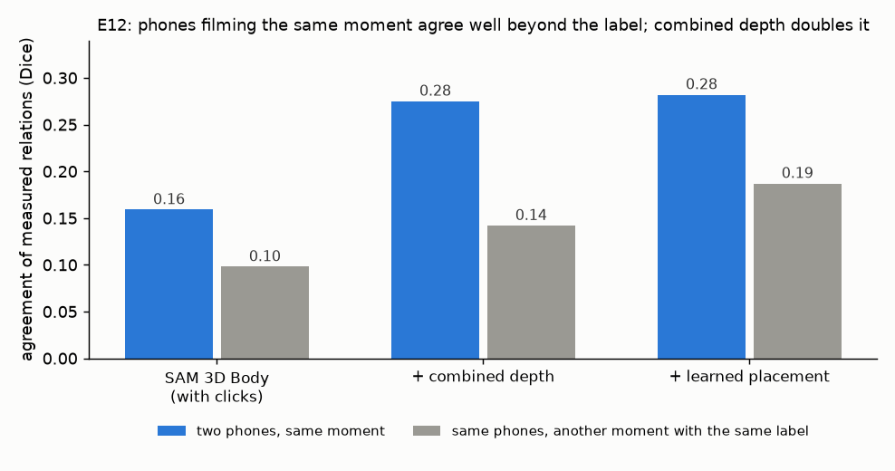

# E12 — Ground work without 3D truth: do synchronised phones agree?

**Objective.** No 3D truth exists for ground work. ViCoS was filmed by 2-3 phones at once, so agreement between phones
at the same moment is a reliability measure that needs none. Also: does the learned placement carry over to ground
work, and can MapAnything turn the phones into usable 3D?

**Setup.**
- 492 synchronised moments (1,223 images) over all 10 positions.
- Pipelines: SAM 3D Body with keypoint clicks; plus the combined depth; plus the learned placement (E06).
- Agreement: overlap of the threading relations measured in two phones at the same moment, against the same phones at
  another moment with the same label. Criteria fixed in advance.

**Results**
| | same moment | same label, other moment | beyond the label |
|---|---|---|---|
| SAM 3D Body (clicks) | 0.16 | 0.10 | +0.06 |
| + combined depth | 0.28 | 0.14 | **+0.13** |
| + learned placement | 0.28 | 0.19 | +0.09 |

**Verdict.** **A1 pass** (single-phone relations carry information about the moment); **A2**: the combined depth is the
more reliable pipeline; **B1 fail** (the learned placement, trained standing, improves only half guard on the ground);
**C1 pending** (MapAnything's environment needs a manual install).
**Learned.** Cross-phone agreement works as a truth-free reliability score. The learned placement pulls bodies towards
typical configurations rather than towards the moment, so ground work needs its own training data.
**Next.** Part C (MapAnything pseudo-3D) once installed; ground-work 3D truth (capture).

Files: `PREREG.md` (committed before the run), `RESULTS.md`. Code: `src/engage_vicos_sync.py`.
