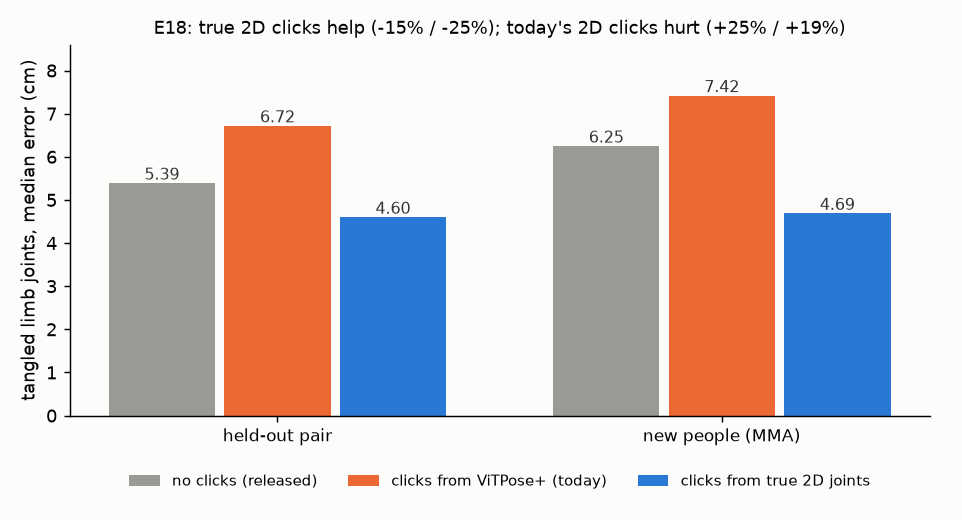

# E18 — Do true 2D keypoints fix tangled limbs in SAM 3D Body?

**Objective.** The ceiling of the input route: given the true 2D joints as clicks, how much tangled-limb error goes
away, and how much does today's 2D model (ViTPose+) already deliver? It decides between a better 2D model and a
bigger fine-tune.

**Setup.** E11's test views (1,068 held-out, 1,484 MMA), ground-truth boxes. SAM 3D Body's own click loop (the model
clicks the joint where its 2D estimate is furthest from the given pose; 2 clicks, its trained maximum) fed with
ViTPose+ keypoints or the true joints projected through the true fisheye camera. Criteria fixed in advance.

**Results** (tangled limb joints, median cm)
| | held-out | new people (MMA) |
|---|---|---|
| no clicks | 5.39 | 6.25 |
| ViTPose+ clicks | 6.72 (+25%) | 7.42 (+19%) |
| true 2D clicks | **4.60** (-15%) | **4.69** (-25%) |

**Verdict.** **O1 fail** (held-out needed -25%, got -15%); O3 pass (other joints improve too); **O4 pass** (new
people -25%). Today's 2D model as clicks makes tangled limbs worse.
**Learned.** The input route has a larger ceiling than the decoder fine-tune (-15% / -25% vs -8% / -9%), but only if
the 2D keypoints are right inside tangles; off-the-shelf 2D grabs the partner's limbs.
**Next.** E19: a 2D model trained on contact.

Files: `PREREG.md` (committed before the run), `RESULTS.md`. Code: `src/engage_h4d_clicks.py`.
