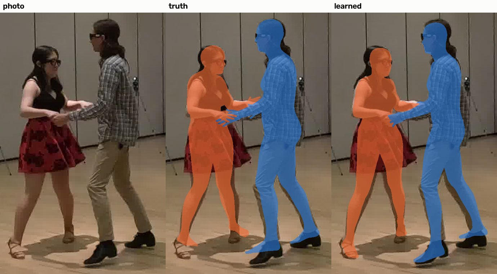
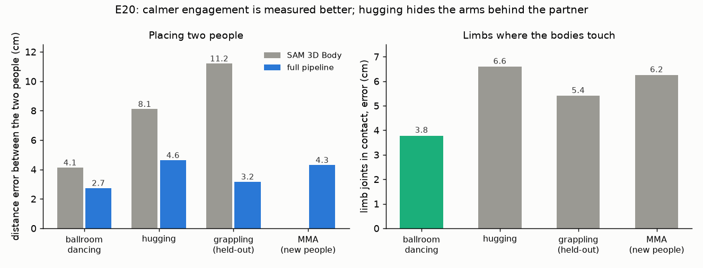
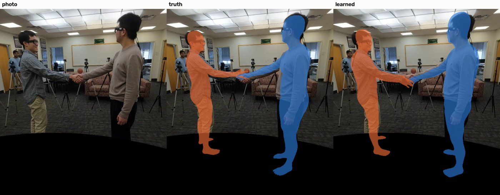

# E20 — Does single-camera engagement measurement already work where contact is calmer?

**Objective.** Grappling is the hardest case of two-person engagement. Hugging and ballroom dancing are meaningful
engagement with calmer contact (an embrace, a dance hold). Does the same pipeline already measure them well?

**Setup.** Harmony4D hugging (604 views) and ballroom (1,132 views) test sequences: new people, activities never
trained on; the unchanged pipeline (SAM 3D Body, combined depth, placement learned on grappling only). Criteria fixed
in advance.

**Results** (full pipeline, medians)
| | ballroom | hugging | grappling (E06/E11) |
|---|---|---|---|
| distance between the two people | **2.7 cm** | 4.6 cm | 3.2 cm |
| touching or not (F1) | **0.96** | 0.89 | |
| limb joints in contact (released model) | **3.8 cm** | 6.6 cm | 5.4 cm |
| embrace detected (F1) | - | **0.89** (SAM 3D Body alone) | - |

**Verdict.** **Fail as pre-registered** (W1-W3 needed both activities; ballroom passes W1 and W3, hugging fails all
three); **W4 passes** (the correction learned on grappling helps both).
**Learned.** Ballroom dancing is a working case today. Hugging is not easier than grappling: the arms wrap out of
view behind the partner. The hard part is hidden limbs at contact, not grappling as such. The embrace itself is
detected (F1 0.89).
**Next.** Engagement at range (E21, sword fighting); hidden limbs remain the target of E11 / E16.

Hugging's typical in-contact moment (the recording includes greetings): 

Files: `PREREG.md` (committed before the run), `RESULTS.md`. Code: `src/engage_demo_easy.py` (figures).
