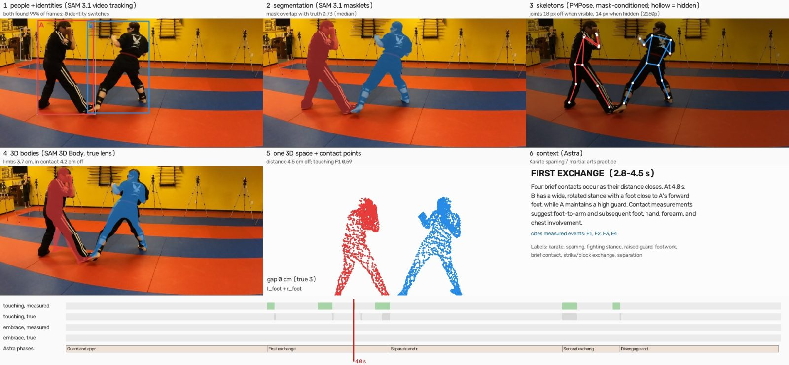
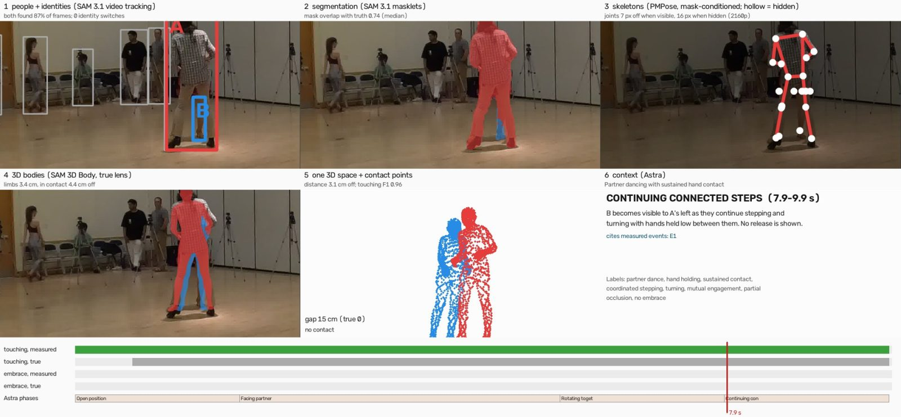
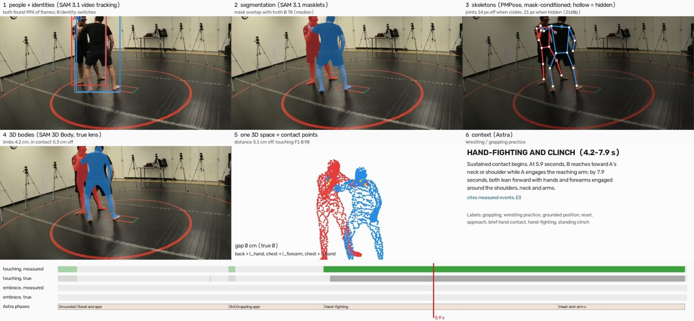
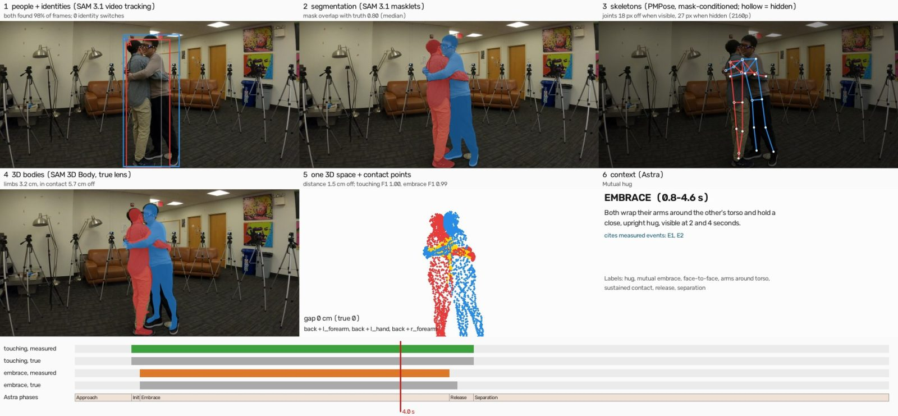

# E22 — Layered engagement: six layers of understanding from one camera, across a spectrum of engagement

**Objective.** Put the pieces together on whole clips: from one camera's video of two people, recover who they are,
their masks, skeletons, 3D bodies in one space, their contact over time, and a narration that cites the measurements,
on engagement from apart (sword sparring) to ground grappling. Score every layer where ground truth exists.

**Setup.** Not pre-registered: a demo and engineering run (the pipeline was improved while it ran). 12 clips with
ground truth (8 Harmony4D, 4 MAMMA West Coast Swing) and 17 ordinary single-camera videos without it, 10 s each. One
camera in; the multi-camera ground truth is used only to score. A queue runs one clip at a time, and a clip counts only
when every layer passes a quality gate. Details: `RESULTS.md`.

**Results** (12 clips with truth)
| layer | result |
|---|---|
| 1 people + identities | 0 identity switches on all 12; both people found in 87-100% of frames |
| 2 segmentation | mask IoU 0.69-0.90 |
| 3 2D skeletons | joints 7-20 px off when visible (hidden: 14-45 px) |
| 4 3D bodies in one space | limbs 2.9-5.2 cm off; distance between the two 1.5-5.1 cm off (Harmony4D), 16-33 cm (MAMMA dance) |
| 5 contact | touching F1 0.96-1.00 on hugging, ballroom and grappling; 0.84-0.92 on West Coast Swing; 0.59-0.75 on strikes; karate's brief touches found 6 of 6 within 0.2 s |
| 6 context | the narration cites the measured events; its "disagreements" field flags where the images and the measurements differ (it caught two tracking errors that passed the gates) |

All 17 clips without truth passed every gate. One low-resolution clip (304x224 VHS) is a documented failure.

**Learned.**
- Difficulty depends on the layer, not one scale: hugging is easy for contact but hides limbs; strikes are hard for
  contact timing; dance seen with one dancer in front of the other is hard for depth from one camera.
- The combined depth (E03/E04) belongs in the live pipeline: distance and contact improved on every truth clip.
- Hands need a looser contact distance than bodies (exploratory, chosen after seeing the data; strict numbers kept).
- The weakest link in the wild is choosing and seeding the right pair in a crowd; three fixes are in `RESULTS.md`.

**Caveats.** SAM 3D Body was trained on Harmony4D, so absolute Harmony4D numbers are likely optimistic. No confidence
intervals (short clips). MAMMA media and the videos without truth are not redistributed.

Files: `RESULTS.md`. Code: `src/engage_demo_layers.py` (all stages), `src/engage_clip.py` (any video as a clip, its
lens and optional truth), `src/engage_clip_make.py` (cut clips; MAMMA truth), `src/engage_demo_render.py` (the
six-panel video), `src/engage_demo_index.py` (gallery), `src/run_queue.sh` (the queue with gates).
Credits: Harmony4D (Khirodkar et al., NeurIPS 2024; MIT); MAMMA (Max Planck Institute for Intelligent Systems);
RF-DETR (Apache-2.0); SAM 3.1 and SAM 3D Body (Meta, SAM License); PMPose (BBoxMaskPose v2); MoGe-2 (MIT); GPT-6
Astra (OpenAI).
